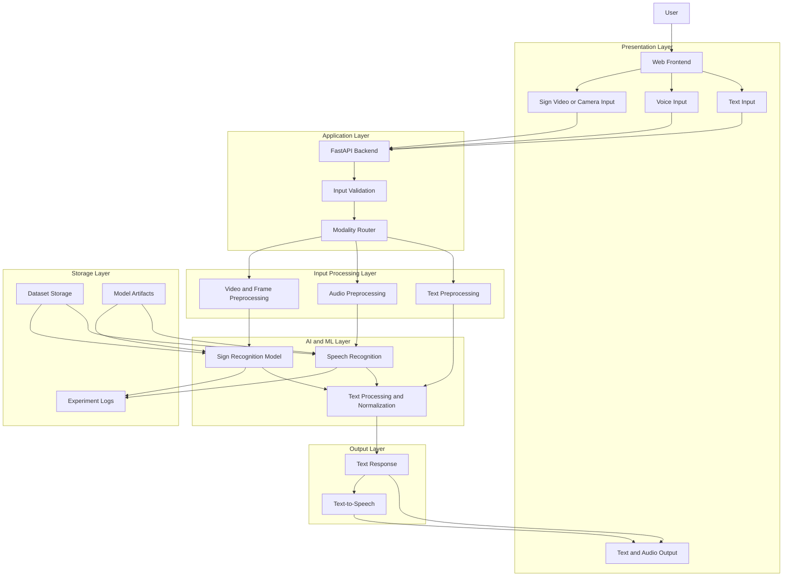
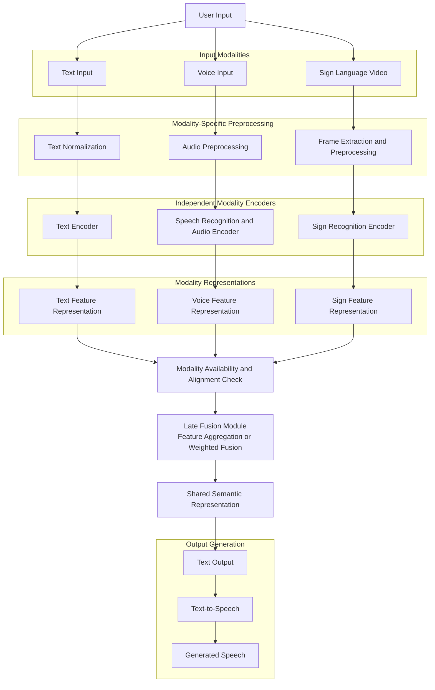
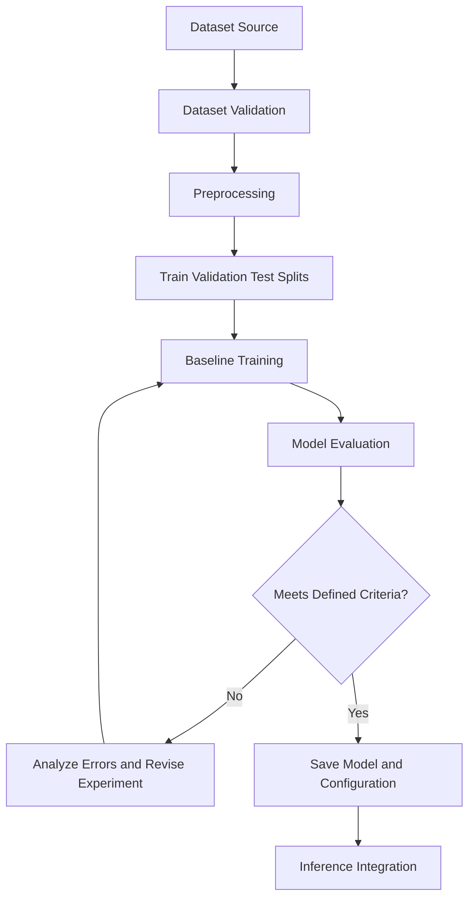

# SignAdapt — System Architecture

**Project:** SignAdapt
**Document:** Technical Architecture
**Version:** 1.0
**Status:** Proposed Architecture
**Related Document:** `PRD.md`

---

## 1. Architecture Overview

SignAdapt is designed as a modular, multimodal AI communication system. It accepts text, voice, and sign-language inputs, processes each modality through a suitable pipeline, and produces text and speech outputs.

The system separates user-interface logic, input processing, AI/ML inference, and output generation. This separation allows individual models to be trained, evaluated, replaced, and improved without redesigning the entire application.

The initial implementation focuses on text and speech outputs. Sign-language generation is reserved for a future phase.

### Architectural Principles

1. Modularity and separation of concerns.
2. Independent processing pipelines for different input modalities.
3. Reusable model-inference components.
4. Reproducible data preparation and model evaluation.
5. Clear interfaces between the frontend and backend.
6. Explicit handling of uncertain predictions and unsupported inputs.
7. Extensibility for future modalities and model architectures.

## 2. High-Level Architecture

The proposed system consists of the following layers:

1. Presentation Layer
2. API and Application Layer
3. Input Processing Layer
4. AI/ML Inference Layer
5. Output Generation Layer
6. Data and Model Storage Layer
7. Evaluation and Experimentation Layer

### Component Diagram



**Note:** This is a proposed logical architecture. Actual deployment boundaries and processing components may change after the initial implementation and experiments.

## 3. Presentation Layer

The presentation layer provides the interface through which users interact with SignAdapt.

### Responsibilities

* Accept text input.
* Capture audio or upload supported audio files.
* Capture sign-language video or accept supported video files.
* Display recognized or processed text.
* Play generated speech.
* Display errors and uncertainty warnings.
* Provide basic controls for starting and stopping input capture.

### Proposed Technologies

* HTML for structure.
* CSS for styling and responsive layout.
* JavaScript for interaction and API requests.

The frontend should remain independent of model implementation details. It communicates with the backend through documented API endpoints.

## 4. API and Application Layer

FastAPI is the proposed backend framework.

### Responsibilities

* Expose endpoints for the different input modalities.
* Validate requests and uploaded files.
* Route inputs to the appropriate processing pipeline.
* Invoke inference components.
* Return text results and speech-generation responses.
* Handle exceptions and processing failures.
* Provide health and model-readiness checks.

### Proposed API Endpoints

| Method | Endpoint                | Purpose                                 |
| ------ | ----------------------- | --------------------------------------- |
| GET    | `/health`               | Check application health                |
| POST   | `/api/v1/text`          | Process text input                      |
| POST   | `/api/v1/voice`         | Process audio input                     |
| POST   | `/api/v1/sign`          | Recognize supported sign-language input |
| POST   | `/api/v1/speech`        | Generate speech from text               |
| GET    | `/api/v1/models/status` | Check model availability                |

The endpoint names are proposed and can be adjusted during implementation.

### API Design Principles

* Use consistent JSON responses for text-based operations.
* Use multipart file uploads or an appropriate media transport for audio and video.
* Apply file-size and file-type validation.
* Return meaningful HTTP status codes.
* Avoid exposing internal exceptions or sensitive file paths.
* Include request identifiers where useful for debugging.

## 5. Input Processing Layer

Each modality has its own preprocessing pipeline.

### 5.1 Text Pipeline

**Input:** User-entered text.

Processing steps:

1. Validate that the input is present and within configured limits.
2. Normalize the text only where appropriate.
3. Preserve meaningful punctuation and semantic information.
4. Pass the processed text to the output pipeline.

The initial version does not require a separate large language model merely to accept and display text.

### 5.2 Voice Pipeline

**Input:** Audio captured from a microphone or uploaded by the user.

Processing steps:

1. Validate the audio format and size.
2. Decode the audio and convert it to the format expected by the recognizer.
3. Apply required resampling or normalization.
4. Pass the audio to the speech-recognition component.
5. Obtain the transcription.
6. Check for empty, invalid, or low-confidence results where confidence information is available.
7. Pass the resulting text to the output pipeline.

The speech-recognition engine remains a replaceable component until its selection is finalized.

### 5.3 Sign-Language Pipeline

**Input:** Camera frames or a supported video file.

Processing steps:

1. Validate the video input.
2. Decode frames at an appropriate sampling rate.
3. Resize and normalize frames as required by the selected model.
4. Extract spatial, temporal, or landmark features if the chosen architecture requires them.
5. Pass the resulting representation to the sign-recognition model.
6. Convert model predictions into supported text labels or sequences.
7. Check prediction confidence and handle unsupported inputs.
8. Pass the recognized text to the output pipeline.

The precise processing pipeline depends on the dataset, whether the task involves isolated signs or continuous signing, and the selected model architecture.

## 6. AI/ML Inference Layer

The inference layer contains the components that interpret the supported inputs.

### 6.1 Speech Recognition

This component converts audio into text.

Its interface should accept preprocessed audio and return a transcription with relevant metadata, such as confidence or processing duration when available.

### 6.2 Sign-Language Recognition

This component predicts supported signs or sequences from video-derived inputs.

Its implementation may use a suitable combination of computer vision, landmark extraction, temporal modeling, or deep learning.

The specific model must be chosen after reviewing the dataset and research objectives. No single architecture is assumed to be optimal before experimentation.

### 6.3 Text Processing and Normalization

This component receives text from the text-input, speech-recognition, and sign-recognition pipelines.

Its responsibilities include:

* Applying only necessary normalization.
* Preserving the meaning of recognized content.
* Formatting text for display and speech generation.
* Representing uncertainty and unsupported predictions.
* Providing a consistent output interface across modalities.

The initial architecture does not require a shared multimodal neural network. Separate modality-specific models can be integrated through common software interfaces.

## 6.4 Multimodal Late Fusion Architecture

### Overview

SignAdapt will investigate a multimodal late fusion architecture to integrate information obtained from text, voice, and sign-language inputs.

In late fusion, each input modality is processed by its own preprocessing pipeline and modality-specific encoder. The resulting feature representations or model-level predictions are subsequently combined by a fusion module to produce a shared semantic representation.

This approach preserves modality-specific processing while allowing information from multiple available modalities to contribute to the final interpretation.

The architecture is designed to support both single-modality operation and multimodal fusion. When only one input modality is available, the system can use its corresponding processing branch. When multiple modalities are available and aligned, the fusion module can combine their representations.

### Architecture Flowchart



### Processing Stages

**Stage 1: Modality-specific input processing**

Text, voice, and sign-language inputs are processed independently. Text undergoes appropriate normalization, voice input is processed through audio preprocessing and speech-recognition components, and sign-language video is converted into model-compatible frames or features.

**Stage 2: Independent feature extraction**

Each modality-specific encoder produces a representation appropriate to its input. The representations may differ in dimensions and structure, so the implementation must define compatible feature interfaces before fusion.

**Stage 3: Modality availability and alignment**

The system determines which modalities are available and whether their inputs correspond to the same communication event. Missing modalities must be handled explicitly rather than treated as valid zero-valued features without justification.

**Stage 4: Late fusion**

The fusion module combines the available modality representations. Candidate approaches include concatenation followed by a learned fusion layer, confidence-weighted aggregation, or attention-based fusion.

The final fusion method will be selected through controlled experiments. Confidence-weighted fusion should only be used when the confidence scores are meaningful and sufficiently calibrated.

**Stage 5: Shared semantic representation**

The fused representation is mapped to a common representation suitable for producing the system's intended textual meaning. Its exact implementation will depend on the selected models and training objectives.

**Stage 6: Output generation**

The resulting representation is converted into text. Text-to-speech can then generate audio from that text. Sign-language generation remains outside the scope of the initial implementation.

### Important Implementation Considerations

* Late fusion requires a defined mechanism for combining representations or predictions; simply running three independent models does not constitute multimodal fusion.
* Simultaneous multimodal inputs must be aligned appropriately. Combining unrelated text, audio, and video could reduce accuracy.
* The system should support missing modalities and fall back to an available input branch when appropriate.
* Modality-specific and fused approaches should be evaluated separately to determine whether fusion provides measurable benefits.
* Evaluation should include modality ablation, where one or more input branches are removed, to quantify each modality's contribution.

### Research Evaluation

The proposed late fusion approach will be compared against appropriate single-modality baselines.

Potential evaluation measures include task-appropriate accuracy, precision, recall, F1-score, latency, and robustness to missing modalities. The choice of metrics will depend on the dataset and prediction task.

The architecture represents a research hypothesis, not a guarantee that late fusion will outperform individual models. Its effectiveness must be demonstrated experimentally.


## 7. Output Generation Layer

### 7.1 Text Output

The text-output component returns a readable result to the frontend.

It should distinguish between:

* Direct text input.
* Speech-derived transcription.
* Sign-recognition output.
* Errors, incomplete results, or uncertain predictions.

This distinction helps users understand how the result was obtained.

### 7.2 Speech Output

The text-to-speech component converts supported text into playable audio.

The implementation may use a local speech engine or an external service, depending on the final technology selection.

The output should be returned through an appropriate audio response or downloadable audio resource.

### 7.3 Future Sign-Language Output

Sign-language generation is not part of the initial implementation.

A future module may generate sign-language representations using an appropriate avatar, animation, or video-generation approach. Its design will require separate research into linguistic structure, representation, synchronization, and evaluation.

## 8. Data and Model Storage

The initial project can operate without a production database if persistent user accounts or conversation histories are not required.

### Proposed Directory Structure

```text
SignAdapt/
├── frontend/
│   ├── index.html
│   ├── css/
│   └── js/
├── backend/
│   ├── app/
│   │   ├── main.py
│   │   ├── api/
│   │   ├── schemas/
│   │   ├── services/
│   │   ├── pipelines/
│   │   ├── models/
│   │   └── core/
│   └── tests/
├── ml/
│   ├── data_preparation/
│   ├── training/
│   ├── evaluation/
│   └── experiments/
├── data/
│   ├── raw/
│   ├── processed/
│   └── splits/
├── artifacts/
│   └── models/
├── docs/
│   ├── architecture.md
│   ├── research-plan.md
│   ├── experiment-log.md
│   └── current-status.md
├── requirements.txt
├── .env.example
├── .gitignore
├── PRD.md
└── README.md
```

This is a proposed layout, not a claim about the current repository. Existing project conventions should be inspected before files are moved or renamed.

### Storage Responsibilities

* `data/raw/`: original datasets, preserved without modification.
* `data/processed/`: transformed and preprocessed data.
* `data/splits/`: reproducible training, validation, and test split definitions.
* `artifacts/models/`: saved model weights and inference artifacts.
* `ml/experiments/`: experiment scripts, configurations, and evaluation procedures.
* `docs/`: project requirements, architecture, research plans, and progress.

Large datasets and model artifacts should normally be excluded from Git and managed separately. Dataset licences and download instructions must be documented.

A relational database such as PostgreSQL may be introduced later if the application needs persistent users, sessions, or experiment metadata.

## 9. Research and Experimentation Architecture

Training and evaluation should remain separate from normal application inference.

### Training Workflow



### Experiment Requirements

Each experiment should record:

* Dataset version and source.
* Preprocessing configuration.
* Train, validation, and test split definitions.
* Model architecture and hyperparameters.
* Training environment and random seeds where applicable.
* Evaluation metrics.
* Error analysis.
* Limitations and conclusions.

The test set must not be used repeatedly to tune the model. Where subject identities are available, split design should account for potential leakage between subjects.

### Evaluation Metrics

Sign recognition may be evaluated using accuracy, precision, recall, F1-score, confusion matrices, or sequence-level error metrics as appropriate.

Speech recognition may be evaluated using Word Error Rate or Character Error Rate.

System evaluation should also measure inference latency, resource use, failure handling, and end-to-end processing time.

## 10. Error Handling and Reliability

The system should handle the following cases:

* Empty text or audio input.
* Unsupported file formats.
* Corrupted audio or video.
* Missing model artifacts.
* Unavailable microphone or camera.
* Model inference failures.
* Unsupported signs or vocabulary.
* Uncertain predictions.
* Backend timeouts or unavailable external services.

Errors should be logged without unnecessarily storing raw audio, video, or other sensitive user content.

The system should not present uncertain recognition results as guaranteed translations.

## 11. Privacy and Security

* Validate file uploads and restrict allowed formats and sizes.
* Avoid logging raw audio and video unless explicitly required and appropriately authorized.
* Keep API keys and credentials in environment variables.
* Exclude `.env` files and sensitive artifacts from version control.
* Use secure transport when deployed.
* Clearly disclose when audio or video is processed by an external service.
* Define data-retention behavior before implementing persistent user histories.

## 12. Deployment Architecture

For local development, the frontend and FastAPI backend may run as separate processes on the same machine.

The frontend sends requests to the backend through a configurable API base URL. The backend loads the required inference components and returns text or audio results.

For future deployment, the frontend and backend can be hosted separately or together, depending on infrastructure and model requirements.

Training workloads should not block the application server. If training or inference becomes resource-intensive, those operations can be moved to dedicated workers or separate services.

Docker and cloud deployment are not mandatory for the initial architecture.

## 13. Architectural Decisions and Open Questions

The following decisions must be confirmed during implementation:

1. Which sign language and dataset will be supported first?
2. Will sign recognition initially target isolated signs or continuous signing?
3. Which speech-recognition engine will be used?
4. Which sign-recognition baseline will be evaluated?
5. Will inference run locally or use external services?
6. Which text-to-speech engine best fits the project?
7. Is persistent storage necessary for the initial version?
8. What numerical performance targets are realistic for the selected dataset and hardware?

These decisions should be recorded when validated rather than assumed in advance.

## 14. Implementation Phases

### Phase 1: Project Foundation

* Establish the frontend and FastAPI backend.
* Define API contracts and validation.
* Create the basic text-input and text-output workflow.

### Phase 2: Voice Processing

* Integrate speech recognition.
* Implement text-to-speech.
* Measure latency and transcription quality.

### Phase 3: Sign Recognition

* Select and validate the dataset.
* Establish a baseline recognition model.
* Build the video-preprocessing and inference pipeline.
* Evaluate model performance and limitations.

### Phase 4: Integration

* Connect the three input pipelines to the shared output layer.
* Test API behavior and error handling.
* Verify end-to-end workflows.

### Phase 5: Research Evaluation

* Compare selected approaches.
* Run controlled experiments.
* Perform error analysis.
* Document results and limitations.

### Phase 6: Future Extensions

* Investigate sign-language output generation.
* Explore expanded vocabulary and continuous recognition.
* Consider further deployment and personalization requirements.

## 15. Maintenance

This architecture document describes the proposed design.

When the implementation changes materially, update this document to reflect the actual system. Keep requirements in `PRD.md`, research methodology in `research-plan.md`, experiment results in `experiment-log.md`, and implementation progress in `current-status.md`.

The architecture should evolve based on tested requirements, measured results, and documented decisions rather than assumptions.

---

**End of Architecture Document**
